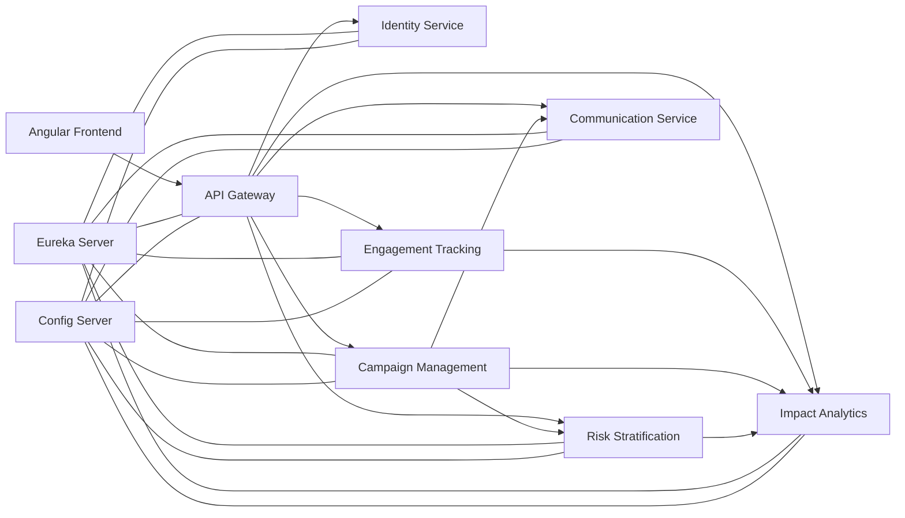

# PreventHub

PreventHub est une plateforme de prevention et de sante publique basee sur une architecture microservices Spring Cloud et un frontend Angular premium. Le projet a ete concu pour une soutenance d'ecole d'ingenieur avec un niveau de finition proche d'un produit SaaS.

## Vue d'ensemble

- `backend/` : microservices Spring Boot, Spring Cloud, OpenFeign, PostgreSQL et Swagger.
- `frontend/` : application Angular 19 standalone avec Tailwind, PrimeNG, Angular Material et ApexCharts.
- `docs/` : conception, diagrammes, endpoints et guide de demonstration.
- `report/` : rapport academique LaTeX.
- `docker-compose.yml` : orchestration complete de la plateforme.

## Architecture



## Workflow fonctionnel

1. Un administrateur ou un professionnel de sante se connecte via `identity-service`.
2. Le frontend recupere un JWT puis consomme le systeme via `api-gateway`.
3. Une campagne est creee dans `campaign-management-service`.
4. Le service de campagne interroge `risk-stratification-service` pour evaluer les populations cibles.
5. `communication-service` simule l'envoi multicanal et historise les messages.
6. `engagement-tracking-service` suit l'ouverture, la participation et l'abandon.
7. `impact-analytics-service` consolide les KPIs pour les tableaux de bord.

## Lancement rapide

### Docker Compose

```bash
docker compose up --build
```

### Backend en local

Depuis `backend/` :

```bash
mvn clean package
```

Puis lancer dans l'ordre :

1. `config-server`
2. `service-registry`
3. `identity-service`
4. `campaign-management-service`
5. `risk-stratification-service`
6. `engagement-tracking-service`
7. `impact-analytics-service`
8. `communication-service`
9. `api-gateway`

### Frontend en local

Depuis `frontend/` :

```bash
npm install
npm run start
```

En local, l'application Angular de developpement ecoute sur `http://localhost:4301`.

## Ports

- `4200` : frontend Docker/Nginx
- `4301` : frontend Angular en developpement local
- `8080` : API Gateway
- `8761` : Eureka Server
- `8888` : Config Server
- `8091` : Identity Service
- `8092` : Campaign Management Service
- `8093` : Risk Stratification Service
- `8094` : Engagement Tracking Service
- `8095` : Impact Analytics Service
- `8096` : Communication Service

## Comptes de demonstration

- `admin@preventhub.io / PreventHub!2026`
- `doctor@preventhub.io / PreventHub!2026`
- `agency@preventhub.io / PreventHub!2026`
- `collectivite@preventhub.io / PreventHub!2026`

## Documentation

- [Architecture detaillee](./docs/architecture.md)
- [Structure du projet](./docs/project-structure.md)
- [Runbook](./docs/runbook.md)
- [Catalogue d'API](./docs/api-endpoints.md)
- [Guide de soutenance](./docs/demo-script.md)
- [Rapport academique](./report/preventhub-report.tex)
